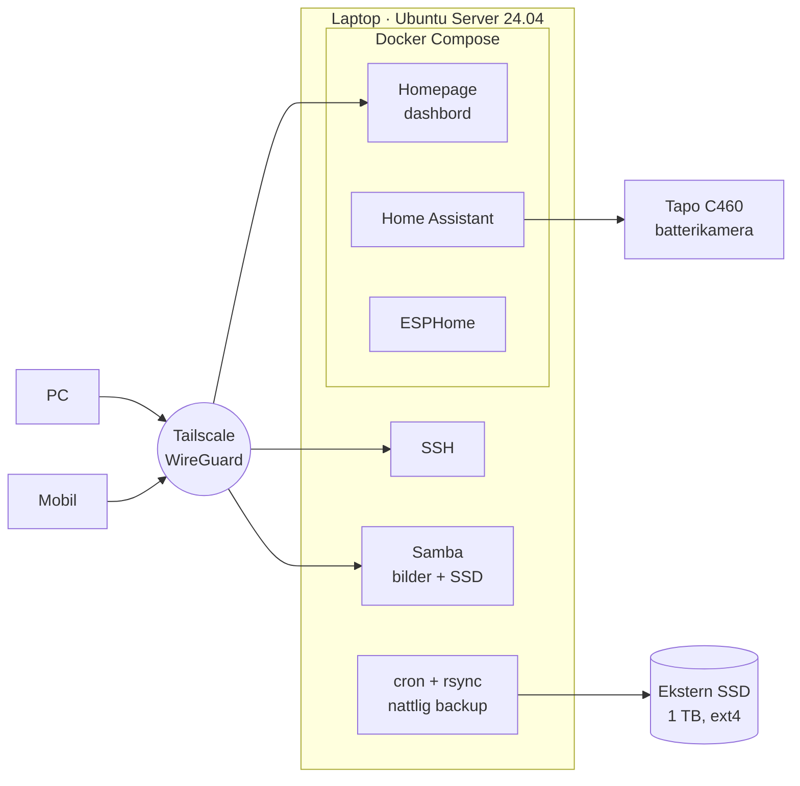

# Hjemmeserver

En gammel laptop gjort om til hjemmeserver med Ubuntu Server. Den lagrer familiebildene med automatisk nattlig backup, kjører smarthus med Home Assistant og ESPHome, og gir sikker tilgang hjemmefra og utenfra via Tailscale, uten at en eneste port er åpnet i ruteren.

Alt kjører på maskinvare jeg allerede hadde: en laptop og en ekstern 1 TB SSD.

## Arkitektur



## Hva den gjør

| Tjeneste | Hva | Hvordan |
|---|---|---|
| Nettverkslagring | Familiebildene og ekstra lagring som nettverksdisker i Windows (Z: og Y:) | Samba |
| Backup | Kopierer bildene og alle innstillinger til ekstern SSD hver natt kl. 03:00 | cron + rsync |
| Smarthus | Styring, automasjoner og live-bilde fra kamera | Home Assistant i Docker |
| Egne sensorer | Programvare til ESP8266-kort (D1 Mini) | ESPHome i Docker |
| Dashbord | Én startside med lenker og status for alle tjenestene | Homepage i Docker |
| Fjerntilgang | Privat, kryptert nettverk mellom mine enheter. Ingen åpne porter | Tailscale (WireGuard) |
| Bilder fra mobilen | Filer sendt fra telefonen havner automatisk i bildemappa | Taildrop + systemd-tjeneste |
| Systemstatus | Batteri, IP-er, disk, temperatur og containere med én kommando | Eget Bash-skript |

## Teknologi

Ubuntu Server 24.04 · Bash · Docker og Docker Compose · Samba · rsync og cron · systemd · netplan · ufw · OpenSSH · Tailscale/WireGuard · Home Assistant · ESPHome · HACS

## Sikkerhet

- **Ingen porter åpne mot internett.** All tilgang utenfra går gjennom Tailscale, som bygger kryptert WireGuard-tunnel direkte mellom enhetene.
- **Brannmur (ufw)** blokkerer alt inn til serveren unntatt det tjenestene trenger.
- **Nøkkelbasert SSH** fra PC-en.
- **Tjenestene kjører isolert i Docker**, med data i egne mapper på serveren, så de kan oppdateres eller bygges på nytt uten å miste noe.
- **Alt er lokalt.** Home Assistant sender ingenting til skyen, og kameraet styres direkte over hjemmenettet.

## Utfordringer jeg løste

- **Dobbel NAT.** Hjemme står to rutere etter hverandre, så enheter på hver sin ruter fant ikke hverandre. Løst ved å koble serveren med kabel til hovedruteren og bruke Tailscale for all tilgang. Da spiller det ingen rolle hvilket nett klienten står på.
- **Serveren mistet nettet etter omstart** og hadde bare Dockers interne adresse (`172.17.0.1`). Feilsøkt med `networkctl` og `ip`, løst ved å bytte fra ustabilt Wi-Fi til kabel og sette opp grensesnittet med netplan.
- **Batterikamera uten RTSP og ONVIF.** Tapo C460 støtter ikke standard videostrøm. Integrert i Home Assistant via en tredjepartsintegrasjon som bruker TP-Links egen protokoll, og satt opp for å spare batteri.
- **Filrettigheter mellom tjenester.** Filer sendt via Taildrop ble eid av root, så Samba ikke viste dem. Løst med en systemd-tjeneste som henter filene som vanlig bruker, slik at de får riktig eier fra starten.
- **Laptop som server.** Dvale og lokkbryter skrudd av, og ladegrense på 80 % så batteriet ikke slites av å stå i laderen hele døgnet. Batteriet fungerer i tillegg som nødstrøm ved strømbrudd.
- **Trygg formatering.** Skriptet som formaterer backup-disken sjekker at disken er USB og ikke systemdisken før det gjør noe.

## Struktur

```
├── README.md
├── docs/                     ← driftsnotater
├── config/
│   ├── homeassistant/        ← Docker Compose for Home Assistant og ESPHome
│   ├── homepage/             ← Docker Compose og oppsett for dashbordet
│   ├── samba/                ← delingene
│   ├── cron/                 ← nattlig backup
│   ├── systemd/              ← automatisk mottak av filer, lokkbryter
│   ├── tmpfiles/             ← ladegrense for batteriet
│   └── fstab.example         ← fast montering av SSD-en
└── scripts/
    └── serverstatus          ← statusoversikt
```

## Dokumentasjon

1. [Oversikt over oppsettet](docs/01-oversikt.md) – hvordan alt henger sammen
2. [Kommandoliste](docs/02-kommandoliste.md)
3. [Tjenester](docs/03-tjenester.md) – hver tjeneste for seg
4. [Feilsøking](docs/04-feilsoking.md)
5. [Oppsett fra bunnen](docs/05-oppsett-fra-bunnen.md) – alt steg for steg
6. [SSD og backup](docs/06-ssd-og-backup.md)
7. [Videre arbeid](docs/07-videre-arbeid.md)
8. [Ordliste](docs/08-ordliste.md)


IP-adresser, brukernavn på tjenester og passord er fjernet eller byttet ut med plassholdere som `100.x.x.x`.
