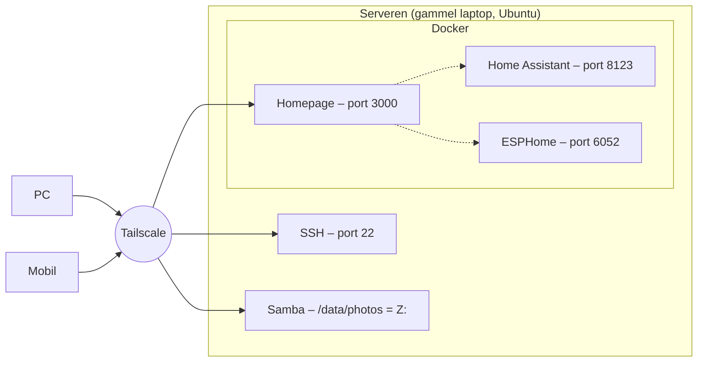

# Oversikt over oppsettet

Tilbake til [README](../README.md)

## Kort fortalt

Serveren er en vanlig PC (den gamle laptopen) som står på hele tiden og kjører noen programmer som andre enheter kan bruke over nettet. Den har ingen skjerm i bruk. Du styrer den fra PC-en.

Den gjør fire ting nå:

1. **SSH** – lar deg styre serveren fra PowerShell på PC-en, så du kan lime inn kommandoer i stedet for å skrive dem på laptopen.
2. **Samba** – deler mappa `/data/photos` på nettet. På PC-en ser du den som disk **Z:**.
3. **Home Assistant og ESPHome** – smarthus-system og verktøy for egne sensorer (D1 Mini osv.). Kjører i Docker.
4. **Homepage** – en startside med knapper til alt det andre. Kjører også i Docker.

I tillegg er **Tailscale** installert. Det er tunnelen som gjør at PC og mobil når serveren, også når du ikke er hjemme.

## Tegning



## IP og port – det viktigste å skjønne

**IP-adresse = adressen til huset. Port = hvilken dør.**

Serveren har én adresse, men flere programmer som står bak hver sin dør og venter på besøk:

| Port | Program        | Hvordan du bruker den                      |
| ---- | -------------- | ------------------------------------------ |
| 22   | SSH            | `ssh server` i PowerShell                  |
| 445  | Samba          | Disk Z: i Utforsker                        |
| 3000 | Homepage       | `http://100.x.x.x:3000/`              |
| 6052 | ESPHome        | `http://100.x.x.x:6052/`              |
| 8123 | Home Assistant | `http://100.x.x.x:8123/home/overview` |

En "nettside" er bare et program som svarer når nettleseren banker på døra. Homepage, Home Assistant og ESPHome er sånne programmer. HTML-en ligger inni programmene, som ble lastet ned ferdig med Docker. Du har ikke skrevet noen nettside selv, bare innstillinger (YAML-filer) som forteller programmene hva de skal vise.

## Serveren har flere IP-adresser

Kjør `minip` eller `hostname -I`, så ser du flere adresser. Det er normalt:

| Adresse | Hva det er |
|---|---|
| `10.0.0.x` | Hjemmenettet (fra hovedruteren via kabelen). Fast, men virker bare hjemme. |
| `100.x.x.x` | Tailscale. Fast, virker overalt. **Bruk denne.** |
| `172.17.0.1` | Docker sitt interne nett. Ikke bruk den til noe. Står den alene, har serveren mistet nettet. |
| `172.18.0.1` | Docker sitt eget nett for Homepage. Ikke bruk den til noe. |
| `127.0.0.1` | «Denne maskinen selv» (localhost). Finnes på alle maskiner. Ikke bruk den til noe. |

Du har to rutere hjemme. Hovedruteren gir `10.0.0.x`. Den andre ruteren lager sitt eget nett med andre adresser (f.eks. `172.x` eller `192.168.x`). Står PC-en på den andre ruteren og serveren på hovedruteren, kan det skape trøbbel med hjemme-IP-en. Med Tailscale spiller det ingen rolle.

## Tailscale

Et privat, kryptert nettverk mellom dine egne enheter. Hver enhet som er logget inn med samme konto, får en fast `100.x.x.x`-adresse og kan nå de andre, uansett hvor de er.

- Trafikken går direkte mellom enhetene og er kryptert (WireGuard). Tailscale kan ikke lese den.
- Ingen porter er åpnet i ruteren. Ingen utenfor kan se serveren.
- Det svake punktet er kontoen du logger inn med. Den bør ha totrinnsbekreftelse.

## Docker

Docker kjører programmer i lukkede "bokser" (containere). Hver boks har alt programmet trenger, så du slipper å installere masse rart på selve serveren.

- **Image** = den nedlastede pakken med programmet (f.eks. `ghcr.io/home-assistant/home-assistant:stable`).
- **Container** = en kjørende kopi av en image.
- **compose.yaml** = oppskriften: hvilken image, hvilke porter, hvilke mapper den får lagre i.
- `docker compose up -d` i mappa med `compose.yaml` laster ned og starter alt.
- `restart: unless-stopped` gjør at containerne starter av seg selv når serveren starter.

Dataene (innstillinger osv.) ligger i vanlige mapper på serveren, ikke inni boksen. Derfor mister du ingenting når du oppdaterer eller sletter en container.

## Brannmuren (ufw)

`ufw` blokkerer alt som kommer inn til serveren, bortsett fra portene du har åpnet. Hver gang du legger til en ny tjeneste med en ny port, må du åpne den: `sudo ufw allow PORT/tcp`. Glemmer du det, laster ikke nettsiden. Se [Feilsøking](04-feilsoking.md).

## Hvor ting ligger på serveren

```
/data/photos/              ← bildene (delt med Samba som "Photos" = Z:)
/mnt/ssd/                  ← den eksterne SSD-en, 1 TB (delt som "SSD" = Y:)
└── backup/                ← nattlig kopi av bildene og innstillingene
/home/jonas/
├── homeassistant/
│   ├── compose.yaml       ← oppskriften for Home Assistant + ESPHome
│   ├── config/            ← alt Home Assistant lagrer
│   └── esphome/           ← ESPHome-filene dine
└── homepage/
    ├── compose.yaml       ← oppskriften for Homepage
    └── config/            ← YAML-filene for dashbordet
/etc/samba/smb.conf        ← Samba-innstillinger
/etc/netplan/              ← nettverksinnstillinger
/usr/local/bin/serverstatus ← status-kommandoen din
```

`~` betyr hjemmemappa di, altså `/home/jonas`.
